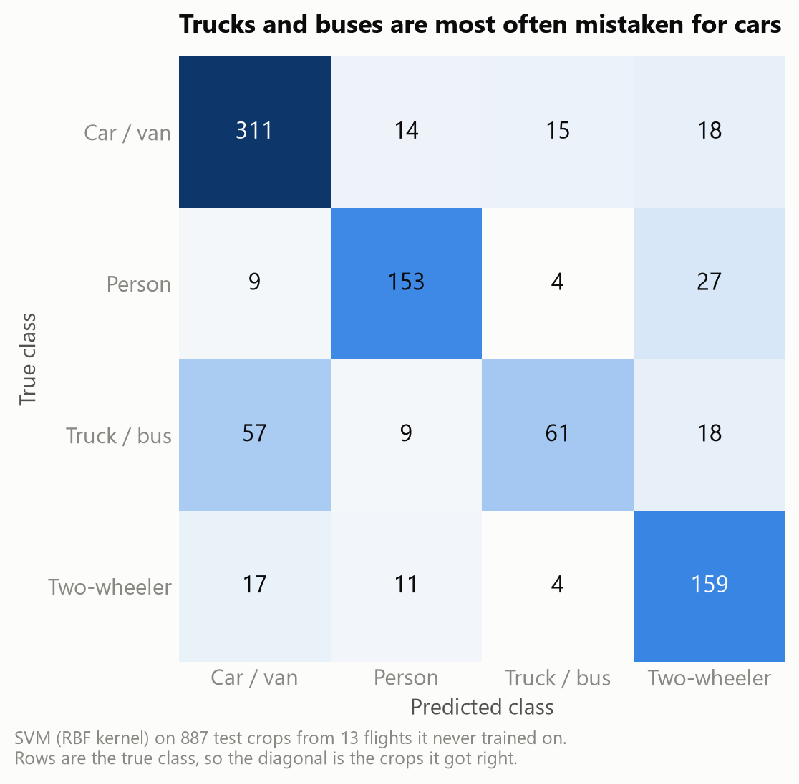

# Aerial Object Classifier

Sourcing Data for Analytics, Week 12 · November 2026

Can a simple model tell people, cars, trucks and motorbikes apart in drone images using only the outline of each object? This pipeline reuses the VisDrone
images from my [Project 2](https://github.com/gsaju65/Project-2), crops out every labeled object, and trains classic scikit-learn models on HOG shape features.



## Result in brief

**Test accuracy = 77.1%** (macro F1 = 0.734). The best model, an SVM, was tested on 887 crops from 13 flights it never saw in training. Always guessing the
most common class gets 40.4%, so the model is well above chance, but it is not equally good at every class. It finds 87% of cars and vans but only 42% of
trucks and buses, and most of the trucks it misses (57 of 145) it calls a car or van. From straight above, a small truck has about the same outline as a van.

| Model | CV accuracy (train) | Test accuracy | Test macro F1 |
|---|---|---|---|
| Baseline (most common class) | 0.380 | 0.404 | 0.144 |
| Logistic regression | 0.657 | 0.673 | 0.640 |
| Random forest | 0.669 | 0.707 | 0.592 |
| **SVM (RBF kernel)** | **0.731** | **0.771** | **0.734** |

| Class (SVM) | Precision | Recall | F1 | Test crops |
|---|---|---|---|---|
| Car / van | 0.789 | 0.869 | 0.827 | 358 |
| Person | 0.818 | 0.793 | 0.805 | 193 |
| Truck / bus | 0.726 | 0.421 | 0.533 | 145 |
| Two-wheeler | 0.716 | 0.832 | 0.770 | 191 |

The SVM was picked by cross-validation on the training flights before the test set was scored. Full output is in [`results/metrics.csv`](results/metrics.csv)
and [`results/classification_report.txt`](results/classification_report.txt).

## Pipeline design

| | |
|---|---|
| **Unit** | One cropped object |
| **Classes** | Person, car/van, truck/bus, two-wheeler |
| **Features** | HOG (histogram of oriented gradients) of the crop at 48x48 grayscale, plus the box's aspect ratio and size: 902 numbers per crop |
| **Models** | Baseline (always the most common class), logistic regression, random forest, SVM with an RBF kernel |
| **Split** | By flight: 13 of the 61 flights (887 crops) are the test set, the other 48 (3,322 crops) are for training |
| **Model choice** | 5-fold cross-validation on the training flights, also grouped by flight |
| **Metric** | Test accuracy, plus macro F1 because the classes are not the same size |

Splitting by flight matters. VisDrone images come in sequences from the same flight, so the same parked car shows up frame after frame. A random split would
put near-copies of test objects into training and make the score look better than it is.

## Repository structure

| Path | Contents |
|---|---|
| `src/download_data.py` | Downloads VisDrone2019-DET test-dev and checks its SHA256 (same script as Project 2) |
| `src/build_dataset.py` | Crops every labeled object and computes its features |
| `src/train.py` | Splits by flight, compares the four models with cross-validation, and trains them |
| `src/evaluate.py` | Scores every model on the test flights and makes the figure |
| `results/` | Model scores and the per-class report |
| `figures/` | Confusion matrix |

## Data

- **Source:** VisDrone2019-DET test-dev, Tianjin University ([VisDrone-Dataset](https://github.com/VisDrone/VisDrone-Dataset)), downloaded from the
  Ultralytics mirror. 1,610 drone images from 61 flights, with a box and a category for every object.
- **What I kept:** objects at least 20 px on each side and not heavily occluded, 28,479 in all. Vans are grouped with cars and trucks with buses, since
  they are hard to tell apart from above. Tricycles are left out.
- **Sample:** at most 40 objects of each class per flight, picked at random (seed 42), for 4,209 crops: 1,619 car/van, 968 two-wheeler, 959 person and
  663 truck/bus. It's the same idea as the 4-per-flight cap in Project 2.
- **Not in this repo:** the images (301 MB; `src/download_data.py` re-creates them), the features and the trained models (the scripts re-create them).

## Reproduction

Requires Python 3.12. From the repository root:

```bash
python -m venv .venv
.venv\Scripts\activate          # macOS/Linux: source .venv/bin/activate
pip install -r requirements.txt
```

**Run the pipeline** (CPU only, under a minute after the download):

```bash
python src/download_data.py     # 1,610 images and labels -> data/raw/
python src/build_dataset.py     # crops + features -> data/processed/dataset.npz
python src/train.py             # split, cross-validation, 4 models -> models/
python src/evaluate.py          # scores -> results/, confusion matrix -> figures/
```

Runs used Python 3.12.10, scikit-learn 1.9.1 and scikit-image 0.26.0.

## Design changes after the first run

The first version used different classes (person, car, large vehicle, two-wheeler), took up to 2,000 crops per class from any flight, and used only HOG
and the aspect ratio. It got 38% to 47% test accuracy, and its cross-validation scores had a standard deviation of 7 to 11 points across folds. Some
flights held far more crops than others, so the score depended heavily on which flights landed in the test set. Before writing up any results, I changed
four things:

- at most 40 crops of each class per flight,
- vans grouped with cars and trucks with buses,
- the box-size feature added,
- the SVM added to the models.

After that, the cross-validation standard deviation dropped to 3 to 5 points.

## Limitations

- **Small test set.** The test set is 13 flights. The SVM's cross-validation accuracy had a standard deviation of 3.5 points, so on a different set of
  flights the test accuracy could easily be a few points higher or lower.
- **Design choices saw every flight.** I picked the class groups, the per-flight cap and the SVM settings by cross-validating across all 61 flights,
  including the 13 that became the test set, so the test score may be slightly optimistic.
- **Shape only.** HOG describes edges and outline, not color or texture, which is why small trucks get mixed up with vans.
- **One part of VisDrone.** I used the same 1,610-image test-dev set as Project 2. VisDrone also has a training set of about 6,500 images that I didn't use.
- **Next time:** pretrained CNN features (for example ResNet) in place of HOG, trained on the bigger VisDrone training set, would likely separate trucks
  from vans better.

## References

Dalal, N., & Triggs, B. (2005). Histograms of oriented gradients for human detection. *IEEE Computer Society Conference on Computer Vision and Pattern
Recognition (CVPR)*, 886-893.

Zhu, P., Wen, L., Du, D., Bian, X., Fan, H., Hu, Q., & Ling, H. (2022). Detection and tracking meet drones challenge. *IEEE Transactions on Pattern Analysis
and Machine Intelligence, 44*(11), 7380-7399.